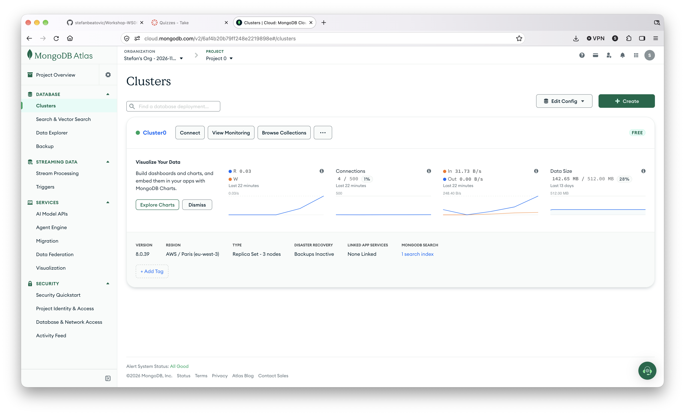
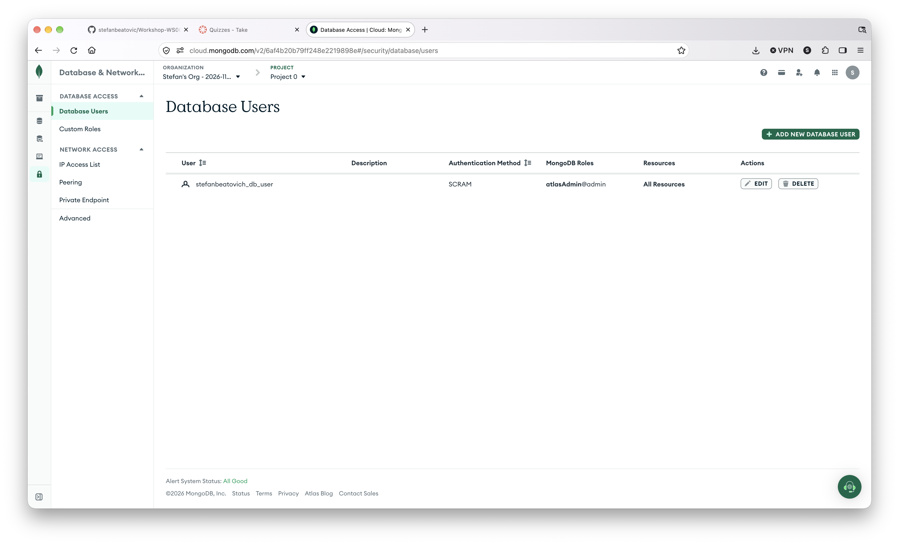
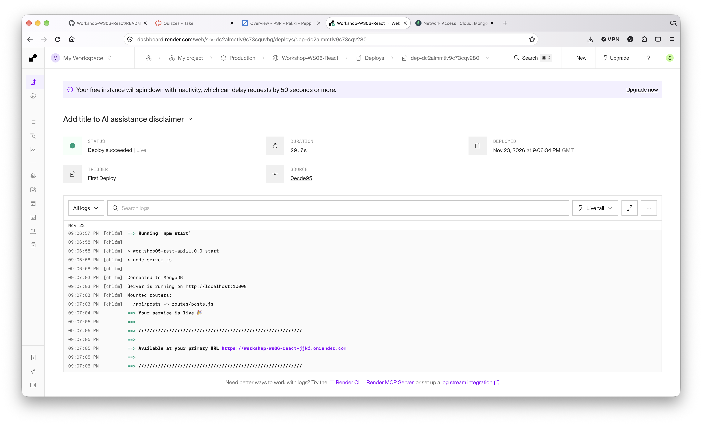
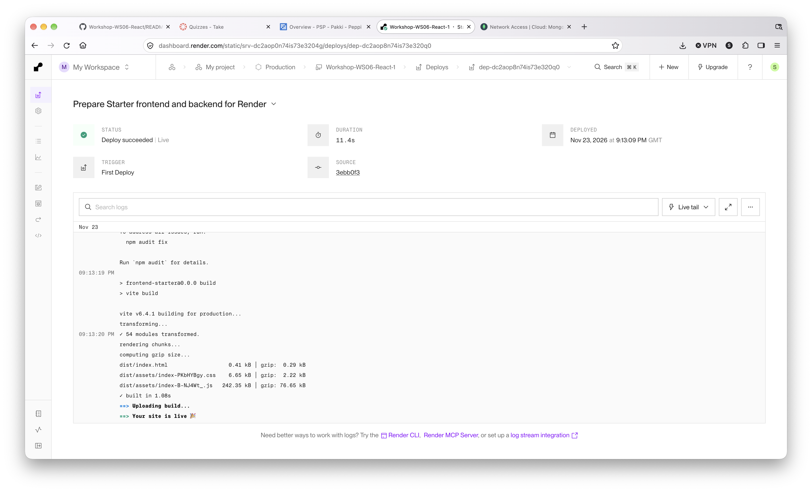

# WS06 React

## Live demo

**Open the deployed application:** https://workshop-ws06-react-1.onrender.com

**Backend API:** https://workshop-ws06-react-backend.onrender.com

This repository contains the WS06 React exercises and the completed Starter React + REST API assignment.

## Current Structure

```text
WS06_React/
├─ README.md
├─ requirements.md
├─ Starter/
│  ├─ backend/
│  │  ├─ .env.example
│  │  ├─ README.md
│  │  ├─ package.json
│  │  ├─ models/
│  │  └─ routes/
│  └─ frontend/
│     ├─ README.md
│     ├─ package.json
│     ├─ vite.config.js
│     └─ src/
└─ tuntiharjoitukset/
```

The repository does not include a `solution/` directory in the current workshop package. The class exercises and mandatory Starter implementation are complete.

## Folder Purpose

- `Starter/`
  - Student workspace with TODOs and guided tasks.
  - Students should implement missing backend and frontend features here.

- `tuntiharjoitukset/`
  - Additional class exercises kept for course support.

## Recommended Workflow

1. Build and test in `Starter/backend`.
2. Build and test in `Starter/frontend`.
3. Compare with `solution/` only when needed.

## Run Instructions

### Backend starter

```bash
cd Starter/backend
npm install
cp .env.example .env
npm run dev
```

### Frontend starter

```bash
cd Starter/frontend
npm install
npm run dev
```

The frontend uses `/api/posts` and expects the backend to run on `http://localhost:3000`.

## Notes

- Keep student implementation work inside `Starter/`.
- Keep `solution/` unchanged as the reference baseline.

## Assignment verification screenshots

The following screenshots show the completed Starter assignment running locally.

### Blog post detail


### Frontend server running


### MongoDB cluster dashboard



### MongoDB database user



### Render backend deployment success



### Render frontend deployment success



## Verification summary

- The backend connected successfully to MongoDB locally and on Render.
- The Express API was implemented for `GET`, `POST`, `PUT`, and `DELETE` `/api/posts`.
- The React frontend builds successfully and is deployed on Render.
- The frontend static site returned HTTP `200`.
- The local backend and frontend CRUD flow were tested in the browser.
- The live backend URL should be redeployed once more after any backend environment or source changes.
- The blog list, create, detail, edit, and delete flows were tested.
- The screenshots confirm the working post detail page, frontend server, MongoDB cluster, database user, and successful Render builds.
- Both the backend and frontend deployments completed successfully on Render.

## AI assistance disclaimer

The student is the main author of this assignment and made the final decisions about the code and content. AI assistance was used to help understand the requirements, review the implementation, troubleshoot deployment, and improve the documentation.
