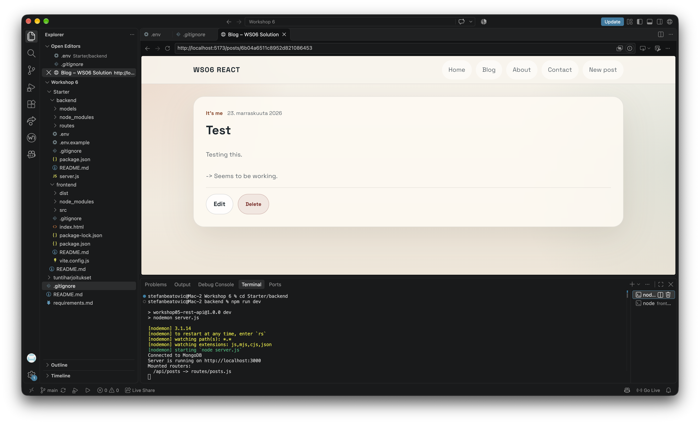
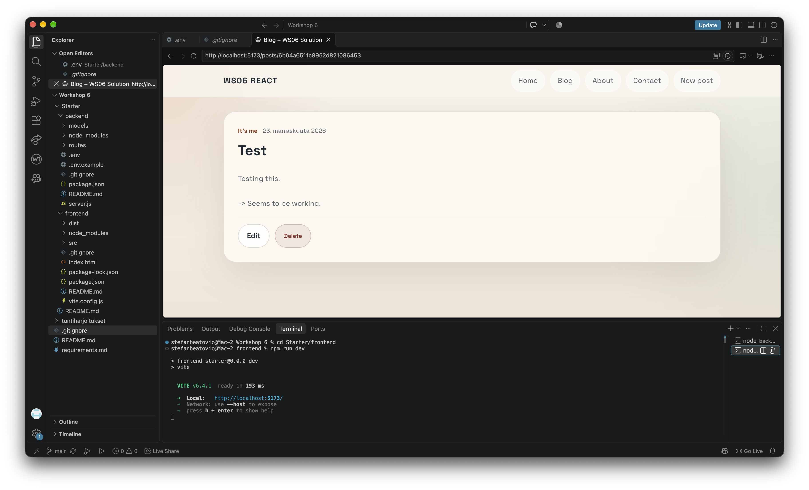

# WS06 React

This repository contains a student starter package and a complete reference solution for the WS06 React + REST API workshop.

## Current Structure

```text
WS06_React/
├─ README.md
├─ requirements.md
├─ Starter/
│  ├─ backend/
│  │  ├─ .env.example
│  │  ├─ README.md
│  │  ├─ package.json
│  │  ├─ models/
│  │  └─ routes/
│  └─ frontend/
│     ├─ README.md
│     ├─ package.json
│     ├─ vite.config.js
│     └─ src/
├─ solution/
│  ├─ backend/
│  │  ├─ README.md
│  │  ├─ package.json
│  │  ├─ server.js
│  │  ├─ models/
│  │  └─ routes/
│  └─ frontend/
│     ├─ README.md
│     ├─ package.json
│     ├─ vite.config.js
│     └─ src/
└─ tuntiharjoitukset/
```

## Folder Purpose

- `Starter/`
  - Student workspace with TODOs and guided tasks.
  - Students should implement missing backend and frontend features here.

- `solution/`
  - Teacher/reference implementation.
  - Use this to compare behavior or review complete code.

- `tuntiharjoitukset/`
  - Additional class exercises kept for course support.

## Recommended Workflow

1. Build and test in `Starter/backend`.
2. Build and test in `Starter/frontend`.
3. Compare with `solution/` only when needed.

## Run Instructions

### Backend starter

```bash
cd Starter/backend
npm install
cp .env.example .env
npm run dev
```

### Frontend starter

```bash
cd Starter/frontend
npm install
npm run dev
```

The frontend uses `/api/posts` and expects the backend to run on `http://localhost:3000`.

## Notes

- Keep student implementation work inside `Starter/`.
- Keep `solution/` unchanged as the reference baseline.

## Assignment verification screenshots

The following screenshots show the completed Starter assignment running locally.

### Blog post detail



### Frontend server running



### MongoDB cluster dashboard


### MongoDB database user


## Verification summary

- The backend connected successfully to MongoDB.
- The Express API started on `http://localhost:3000`.
- The React frontend started on `http://localhost:5173`.
- The blog list, create, detail, edit, and delete flows were tested.
- The screenshots confirm the working post detail page, frontend server, MongoDB cluster, and database user.

## AI assistance disclaimer

The student is the main author of this assignment and made the final decisions about the code and content. AI assistance was used to help understand the requirements, review the implementation, troubleshoot deployment, and improve the documentation.
